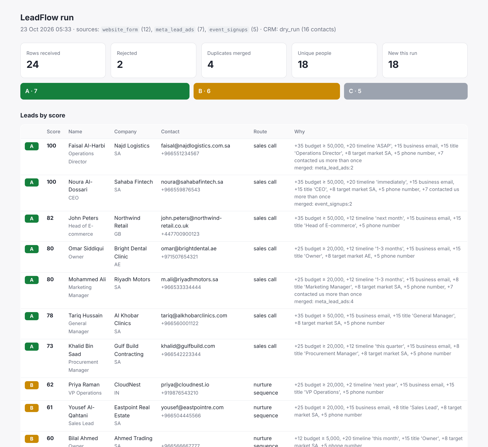

# LeadFlow Automation

Takes messy lead exports from different places (website form, Meta lead ads, event sign-up sheets), cleans them, merges duplicates across sources, scores each lead, and pushes the result to HubSpot. Every run produces a report showing what happened to every row.



## The problem

A sales team in the Gulf typically gets leads from three or four places, each with its own column names and formats. You get `+966 55 123 4567` in one sheet and `0551234567` in another. The same person shows up as `FAISAL AL-HARBI` from Meta and `Faisal Al-Harbi` from the website. Budgets arrive as `SAR 60,000`, `50000+` or `5k`. Importing all of that straight into a CRM creates duplicates and leaves sales guessing who to call first.

## What LeadFlow does

```
website_form.csv ─┐   column mapping      clean + validate          merge             score             push
meta_lead_ads.csv ┼─► (config/sources) ─► phone→E.164, email, ─► same email/phone/ ─► budget, timeline, ─► HubSpot batch upsert
event_signups.csv ┘                       name case, budget       name+domain         title, market…     + CSV + HTML report
                                          (bad rows → rejected)                       → A / B / C
```

- **Column mapping per source** in `config/sources.json`. Adding a new form means adding a mapping, not code.
- **Normalisation:**
  - Phones become E.164 for SA, AE, QA, KW, BH, OM, JO, PK, IN, EG, GB and US, with local numbers handled (`05…` → `+9665…`).
  - Emails are lowercased and validated.
  - ALL-CAPS and lowercase names are fixed.
  - Budgets like `SAR 60,000`, `5k`, `20000-50000`, `50000+` and `under 5000` are all parsed.
- **Enrichment:** business email vs free mail vs disposable domains, and a company name guessed from the domain when it's missing.
- **Duplicate merge across sources:** on the same email, the same phone, or the same company domain plus a similar name ("Mohammed Ali" / "Mohamed Ali"). Gaps are filled from the duplicate, both messages are kept, and the report records which rows were merged.
- **Explainable scoring** from `config/scoring.json`. Each lead gets 0–100, a grade and a route (`sales_call`, `nurture_sequence`, `newsletter_only`), plus the reasons, e.g. `+35 budget ≥ 50,000, +20 timeline 'ASAP', +15 title 'CEO'`.
- **HubSpot** batch upsert by email (100 per call), including custom `leadflow_score`, `leadflow_grade` and `leadflow_route` properties. Without a token it does a dry run and writes the exact API payload to `runs/hubspot_payload.json`.
- **Idempotent:** a small SQLite ledger remembers who was already pushed. Re-running on an overlapping export pushes only the new people (`--resync` overrides).

## Run it

```bash
pip install -r requirements.txt

python -m leadflow run \
  --website_form data/website_form.csv \
  --meta_lead_ads data/meta_lead_ads.csv \
  --event_signups data/event_signups.csv

open runs/report.html          # also: runs/leads_clean.csv, runs/hubspot_payload.json
```

On the sample files: 24 rows in → 2 rejected (`test@test`, `grace@`) → 4 duplicates merged → 18 unique people (7 A, 6 B, 5 C).

To push for real, set `HUBSPOT_TOKEN` (private app with `crm.objects.contacts.write`) and add `--hubspot`.

## Tests

`pytest -q` runs 31 tests:

- phone, email, name and budget parsing (including the awkward cases above)
- dedupe rules, scoring and grading
- the full sample run
- the HubSpot payload, and live mode against a mocked API
- a CLI test proving the second run pushes nothing new

CI also runs the sample pipeline and uploads the report as an artifact.

## Layout

```
leadflow/
  normalize.py   field cleaning + validation
  enrich.py      email domain classification
  dedupe.py      cross-source matching and merging
  scoring.py     config-driven points, grade and route
  sources.py     CSV reading with per-source column mapping
  sinks.py       CSV export, HubSpot batch upsert
  ledger.py      remembers what was already pushed
  report.py      HTML run report (templates/report.html)
config/          sources.json, scoring.json
data/            three fictional lead exports
```

---

Built by [Usman Saleem Bhatti](https://www.upwork.com/freelancers/~017ac7683856df4451). All names, companies and numbers in `data/` are fictional.
