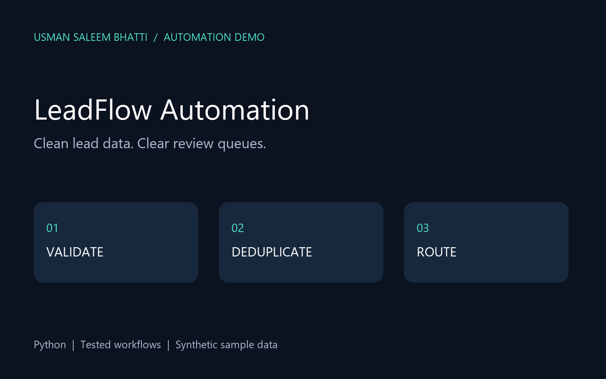

# LeadFlow Automation

CSV lead intake with validation, normalization, duplicate prevention and routing.



**Portfolio demonstration by Usman Saleem Bhatti.** Newly built with AI assistance and synthetic sample data; not represented as past client work.

## Workflow

`CSV input → validation → SQLite ledger → review queue → HTML report`

## Features

Email normalization, input validation, idempotent imports, explicit rejected-record handling, persistent SQLite state.

## Quick start

Python 3.11 or newer. No third-party dependencies.

```sh
python app.py --demo --output runs
python -m unittest discover -v
```

Open `runs/report.html` in a browser. `runs/result.json` contains structured output. Demo reruns reuse their local ledger where applicable; use a fresh output folder to repeat the first-run scenario.

## Custom input

```sh
python app.py --input sample.csv --output runs
```

## What is tested

The unit tests cover the business rules, malformed inputs and important failure paths. The generated `demo-report.html` is a checked-in sample report for quick inspection. Runtime output and databases are ignored by Git.

## Daily checks

The included `checks.yml` is a GitHub Actions workflow template. To activate it, place it at `.github/workflows/checks.yml`. It runs tests and the demo daily and on pushes, retaining run logs and a report artifact. The local portfolio bundle also includes `run_daily_checks.py` for background checks.

## Scope and limitations

No external CRM writes or messages. Routing thresholds are illustrative. Ledger keeps the first valid record for an email; updates need an explicit policy.

## Contact

[Usman on Upwork](https://www.upwork.com/freelancers/~017ac7683856df4451) · [GitHub](https://github.com/Usb01)
